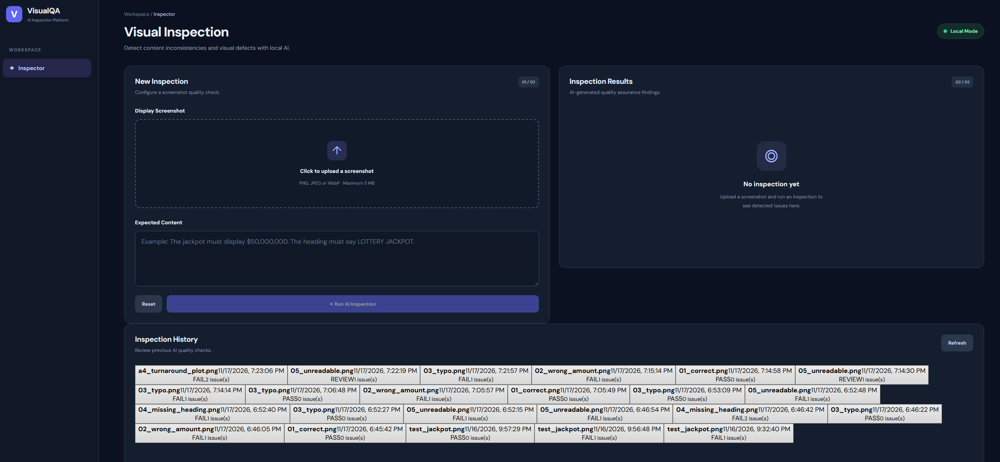
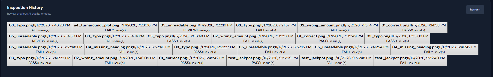

# AI Visual QA Inspector

**A full-stack AI-assisted quality assurance application for inspecting digital signage screenshots, detecting content inconsistencies, and generating structured inspection reports.**

Built using React, TypeScript, Python, FastAPI, Ollama, Gemma 3, RapidOCR, and SQLite.

## Overview

AI Visual QA Inspector explores how computer vision, optical character recognition (OCR), and automated testing can reduce the manual effort involved in checking digital signage content.

Users can upload a screenshot, specify expected content, and receive an inspection report containing a classification, summary, and detected issues.

The application runs locally and stores inspection history in a SQLite database.

### Key Features

- **Screenshot inspection:** Upload PNG, JPEG, or WebP images and specify expected display content.
- **Local AI integration:** Analyze visual content using Gemma 3 through Ollama without relying on a paid cloud inference API.
- **OCR-assisted verification:** Use RapidOCR and deterministic Python comparisons for a controlled lottery-display evaluation layout.
- **Structured QA reports:** Return PASS, FAIL, or REVIEW decisions with issue descriptions and severity levels.
- **Persistent inspection history:** Save and retrieve inspection results using SQLite.
- **REST API:** Expose inspection and history endpoints through FastAPI.
- **Automated testing:** Test API behavior, database persistence, frontend interactions, and controlled screenshot classifications using Pytest and Playwright.

## Technology Stack

| Layer | Technology |
|---|---|
| Frontend | React, TypeScript, Vite |
| Backend | Python, FastAPI |
| Vision AI | Gemma 3 4B, Ollama |
| Text Recognition | RapidOCR, ONNX Runtime |
| Database | SQLite |
| Backend Testing | Pytest, FastAPI TestClient |
| Frontend Testing | Playwright |
| Version Control | Git, GitHub |

## Architecture

```text
React + TypeScript Frontend
           |
           | HTTP / REST
           v
      FastAPI Backend
           |
           +---- Controlled Evaluation Layout
           |         |
           |         v
           |      RapidOCR
           |         |
           |         v
           |   Python Verification Rules
           |
           +---- Other Screenshots
                     |
                     v
                Ollama API
                     |
                     v
                 Gemma 3

           |
           v
    Structured QA Result
           |
           v
      SQLite Database
           |
           v
    Inspection History
```

## Installation

### Prerequisites

- Python 3.11 or newer
- Node.js compatible with the installed Vite version
- npm
- Ollama
- Git
- Sufficient RAM to run the Gemma 3 4B model

### 1. Clone the repository

```bash
git clone https://github.com/Iodeh21/ai-visual-qa-inspector.git
cd ai-visual-qa-inspector
```

### 2. Install the local AI model

Install Ollama from https://ollama.com/download.

Then download Gemma 3:

```bash
ollama pull gemma3:4b
```

Ensure the Ollama service is running locally on port `11434`.

### 3. Set up the backend

The following commands are for Windows PowerShell.

```powershell
cd backend
py -m venv .venv
.\.venv\Scripts\Activate.ps1
python -m pip install -r requirements-dev.txt
```

Create a `.env` file in the `backend` directory:

```dotenv
OLLAMA_MODEL=gemma3:4b
OLLAMA_HOST=http://127.0.0.1:11434
```

Start FastAPI:

```powershell
python -m uvicorn main:app --reload
```

Backend: http://127.0.0.1:8000

API documentation: http://127.0.0.1:8000/docs

The SQLite database is initialized when the backend starts.

### 4. Set up the frontend

Open a second terminal:

```powershell
cd frontend
npm install
npm run dev
```

Open the local URL shown by Vite, normally:

http://localhost:5173

### 5. Run an inspection

1. Upload a screenshot.
2. Enter the expected content.
3. Select **Run AI Inspection**.
4. Review the classification, summary, and issues.
5. Browse previous reports in **Inspection History**.

## API Endpoints

| Method | Endpoint | Description |
|---|---|---|
| GET | `/` | Application information |
| GET | `/health` | Backend health check |
| POST | `/api/inspect` | Analyze an uploaded screenshot and save the result |
| GET | `/api/inspections` | Retrieve saved inspections |
| GET | `/api/inspections/{id}` | Retrieve an individual inspection |

## Testing

### Backend Tests

From the `backend` directory:

```powershell
python -m pytest -v
```

### Frontend Tests

From the `frontend` directory:

```powershell
npx playwright test
```

Run the production build check:

```powershell
npm run build
```

### OCR Evaluation

Five synthetic jackpot screenshots are used for controlled evaluation:

| Screenshot | Expected Classification |
|---|---|
| Correct jackpot and heading | PASS |
| Incorrect jackpot amount | FAIL |
| Misspelled heading | FAIL |
| Missing heading | FAIL |
| Unreadable screenshot | REVIEW |

Generate the evaluation images using:

```powershell
python generate_test_images.py
```

Run the controlled OCR evaluation:

```powershell
python test_inspection_rules.py
```

Additional testing information is available in the `evaluation/` directory.

## Engineering Findings

During initial testing, the vision-language model incorrectly accepted a misspelled heading and classified an unreadable screenshot as a confirmed failure.

This exposed limitations in relying solely on a general-purpose vision model for strict content verification.

A dedicated OCR component was subsequently introduced to extract text, with deterministic Python comparisons used for a controlled lottery-display layout.

This approach improved the repeatability of the benchmark checks and enabled more explicit handling of uncertain observations.

## Current Limitations

- The deterministic OCR inspection path is designed for five known evaluation screenshots, identified using filenames, dimensions, and expected requirements.
- Cropped OCR regions use fixed coordinates for the synthetic jackpot layout.
- Other uploaded screenshots are processed through Gemma 3 without the same deterministic verification guarantees.
- OCR confidence values do not guarantee character-level correctness.
- The application saves inspection metadata and results, not the original uploaded image files.
- Local inference speed depends on available hardware.
- The application is a development prototype and is not intended as a production release gate without additional validation.

## Future Improvements

- User-defined inspection regions and layout templates
- Generalized OCR extraction for arbitrary digital signage layouts
- Visual bounding boxes highlighting detected inconsistencies
- Exportable QA reports
- Larger evaluation datasets and regression benchmarks
- CI pipelines for automated testing

## Project Purpose

This project demonstrates practical integration of local AI models, computer vision, REST APIs, relational databases, and automated testing into a full-stack software application.

It was developed as a software engineering portfolio project with a focus on quality assurance workflows and practical model evaluation.

## License

No open-source license has been selected yet.

## Screenshots

### Inspection Dashboard



### AI-Assisted Defect Detection


### Persistent Inspection History

